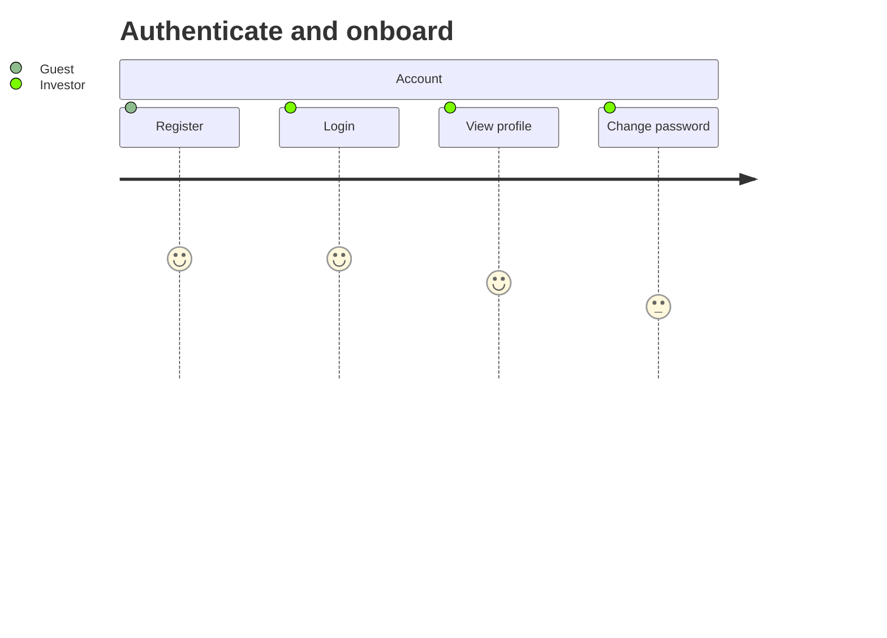
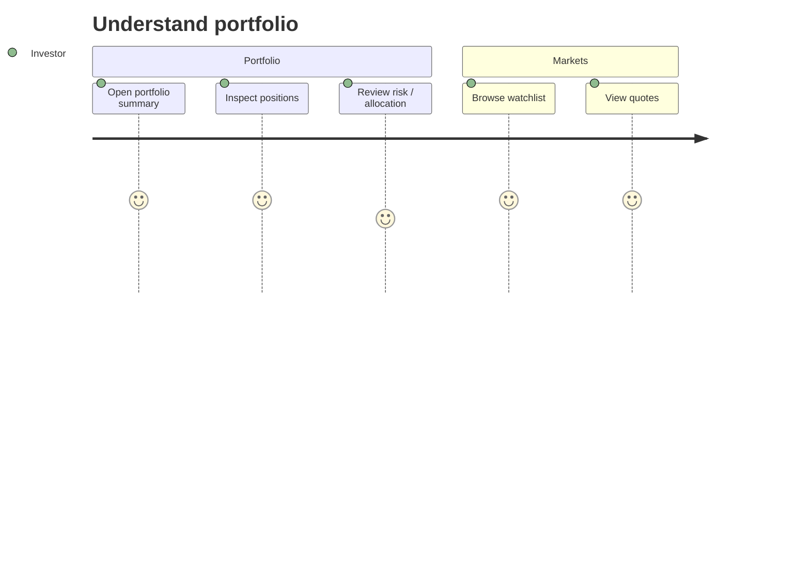
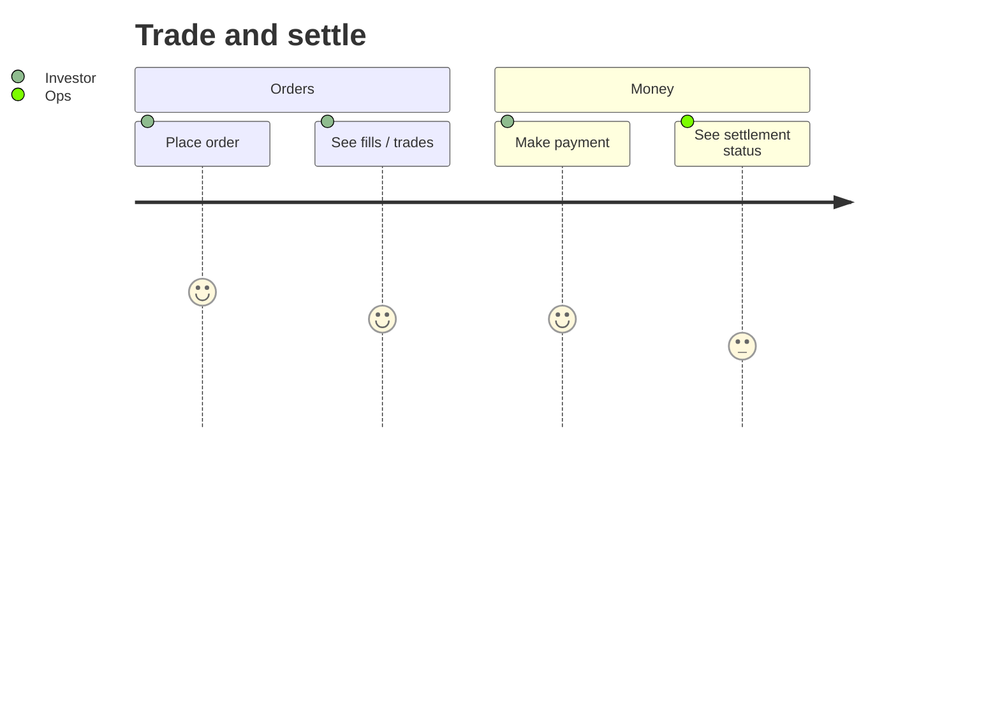
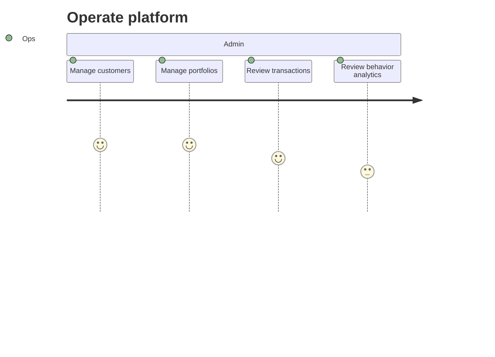

# User Story Map

> Jeff Patton story map + Mermaid journeys + GWT epics in files.  
> Index only; details in [user-stories/](./user-stories/).

## Personas

| Role | Description |
| ---- | ----------- |
| Investor | Uses portal / mobile for portfolio, watchlists, quotes, payments |
| Advisor / Ops | Uses admin to manage customers, accounts, portfolios, transactions |
| Guest / new user | Registers and authenticates |
| Developer | Seeds data, runs local stack, extends APIs |

## Journey overview

### Authenticate and onboard

### Understand portfolio

### Trade and settle

### Operate (Admin)

---

## Backbone story map

### Done

| Auth | Customers & accounts | Instruments & markets | Portfolios | Watchlists & quotes |
| ---- | -------------------- | --------------------- | ---------- | ------------------- |
| [US-01](./user-stories/E1-auth.md#us-01-register) Register | [US-04](./user-stories/E2-customers-accounts.md#us-04-manage-customers) Customers | [US-06](./user-stories/E3-instruments-markets.md#us-06-instrument-catalog) Instruments | [US-08](./user-stories/E4-portfolios-positions.md#us-08-portfolio-crud) Portfolios | [US-10](./user-stories/E5-watchlists-quotes.md#us-10-watchlists) Watchlists |
| [US-02](./user-stories/E1-auth.md#us-02-login) Login | [US-05](./user-stories/E2-customers-accounts.md#us-05-manage-accounts) Accounts | [US-07](./user-stories/E3-instruments-markets.md#us-07-market-data-records) Market data | [US-09](./user-stories/E4-portfolios-positions.md#us-09-positions) Positions | [US-11](./user-stories/E5-watchlists-quotes.md#us-11-quotes) Quotes |
| [US-03](./user-stories/E1-auth.md#us-03-session) Session | | | | |

| Trading | Payments | Analytics | Surfaces | Bonds & options | Blockchain |
| ------- | -------- | --------- | -------- | --------------- | ---------- |
| [US-12](./user-stories/E6-orders-trades.md#us-12-orders) Orders | [US-14](./user-stories/E7-payments-settlements.md#us-14-payments) Payments | [US-16](./user-stories/E8-analytics-risk.md#us-16-portfolio-analytics) Portfolio analytics | [US-18](./user-stories/E9-admin-portal-mobile.md#us-18-admin-console) Admin | [US-21](./user-stories/E10-bonds-options.md#us-21-bonds) Bonds | [US-23](./user-stories/E11-blockchain-demo.md#us-23-blockchain-demo) Blockchain demo |
| [US-13](./user-stories/E6-orders-trades.md#us-13-trades) Trades | [US-15](./user-stories/E7-payments-settlements.md#us-15-settlements--cash) Settlements & cash | [US-17](./user-stories/E8-analytics-risk.md#us-17-behavior--forecast) Behavior & forecast | [US-19](./user-stories/E9-admin-portal-mobile.md#us-19-portal) Portal | [US-22](./user-stories/E10-bonds-options.md#us-22-options) Options | |
| | | | [US-20](./user-stories/E9-admin-portal-mobile.md#us-20-mobile) Mobile | | |

### Planned

| Position & trade invariants |
| --------------------------- |
| [US-24](./user-stories/E12-position-trade-invariants.md#us-24-position-quantity-follows-fills) Position follows fills |
| [US-25](./user-stories/E12-position-trade-invariants.md#us-25-glossary-clarifies-trade-position-settlement) Glossary timing & duty |
| [US-26](./user-stories/E12-position-trade-invariants.md#us-26-domain-model-shows-position-adjustment-behavior) Domain model behavior |

## Epic index

| Epic | File | Stories | Status |
| ---- | ---- | ------- | ------ |
| E1 Auth | [E1-auth.md](./user-stories/E1-auth.md) | US-01 – US-03 | Done |
| E2 Customers & accounts | [E2-customers-accounts.md](./user-stories/E2-customers-accounts.md) | US-04 – US-05 | Done |
| E3 Instruments & markets | [E3-instruments-markets.md](./user-stories/E3-instruments-markets.md) | US-06 – US-07 | Done |
| E4 Portfolios & positions | [E4-portfolios-positions.md](./user-stories/E4-portfolios-positions.md) | US-08 – US-09 | Done |
| E5 Watchlists & quotes | [E5-watchlists-quotes.md](./user-stories/E5-watchlists-quotes.md) | US-10 – US-11 | Done |
| E6 Orders & trades | [E6-orders-trades.md](./user-stories/E6-orders-trades.md) | US-12 – US-13 | Done |
| E7 Payments & settlements | [E7-payments-settlements.md](./user-stories/E7-payments-settlements.md) | US-14 – US-15 | Done |
| E8 Analytics & risk | [E8-analytics-risk.md](./user-stories/E8-analytics-risk.md) | US-16 – US-17 | Done |
| E9 Admin / portal / mobile | [E9-admin-portal-mobile.md](./user-stories/E9-admin-portal-mobile.md) | US-18 – US-20 | Done |
| E10 Bonds & options | [E10-bonds-options.md](./user-stories/E10-bonds-options.md) | US-21 – US-22 | Done |
| E11 Blockchain demo | [E11-blockchain-demo.md](./user-stories/E11-blockchain-demo.md) | US-23 | Done |
| E12 Position & trade invariants | [E12-position-trade-invariants.md](./user-stories/E12-position-trade-invariants.md) | US-24 – US-26 | Planned |

## Related

- [User Story Mapping — Jeff Patton](https://www.jpattonassociates.com/user-story-mapping/)
- [Glossary](../Glossary.md)
- [API](../developer/api.md)
- [C4](../developer/c4-model/)
